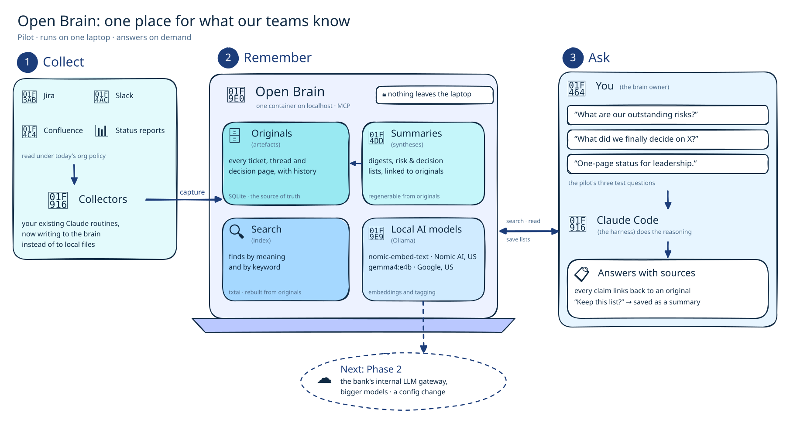

# Open Brain pilot: executive brief

## The problem

What we know about our platforms' work is spread across Jira, Slack, Confluence, status reports and people's heads. Some of us already run Claude routines that scrape these systems, but they write Markdown files to our own laptops. That makes knowledge hard to search, easy to lose and slow to turn into an answer. Questions like "what are our outstanding risks?" or "what did we actually decide about X?" still depend on someone's memory and an afternoon of digging.

## What we're building

**Open Brain** is a small, local service that becomes the place those scraping routines write to, in place of the Markdown files. You then ask it questions through Claude Code.

- **The scrapers stay as they are.** Only their last step changes, from "write a file" to "send it to the brain".
- **It keeps originals, not just summaries.** Every Jira issue, thread or decision page is stored as a faithful copy with its history. Summaries and digests are stored too, linked back to the originals they came from, so an answer can always be traced to its source.
- **Answers are on demand.** There are no reports to build or maintain. You ask a question, and Claude searches the brain, reads what it finds and answers with citations. If an answer is worth keeping, such as a risk list, Claude can save it as a running list and build on it next time.
- **It runs on a laptop.** It is one Docker container plus local AI models through Ollama, from US developers (Nomic AI and Google). The brain sends nothing off the laptop. Reading source systems and using Claude stay under today's org policy.
- **Anyone can run their own.** Each person installs a separate brain from a pinned release with one setup script (Claude Code can run it for them), and a built-in check confirms the install works.

## What the pilot sets out to prove

Real users install the brain on their own laptops, connect their existing scraping routines through our internal setup, and ask it the cross-team leadership questions they answer today. We judge its answers against what their Markdown files give them now, and improve the pilot from that feedback. It passes if the brain answers these questions at least as well:

1. **Outstanding risks:** what threatens the next releases, and whether those risks were resolved.
2. **Finalised architecture decisions:** what was actually decided, not just discussed, and who drove it.
3. **On-demand executive reports:** a one-page status across teams, assembled when it's needed.

## Not in the pilot

- Shared, multi-user or hosted brains: each person has their own.
- Built-in reports or dashboards: answers come from asking.
- Changing how the existing scrapers collect data, or importing old Markdown dumps. History comes from re-scraping instead.
- Sending data to any AI service outside the laptop from the brain itself.

## Next milestone: Phase 2

Connect the brain to the **bank-governed internal LLM gateway**, so it can use larger models for tagging and organising content. We'll evaluate them against the local models first. Because model endpoints are already configuration, this is a settings change, not a rebuild. A shared, central brain could come later still, using the same interface.

